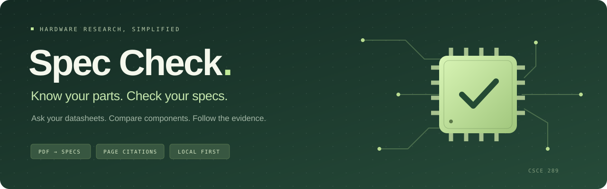
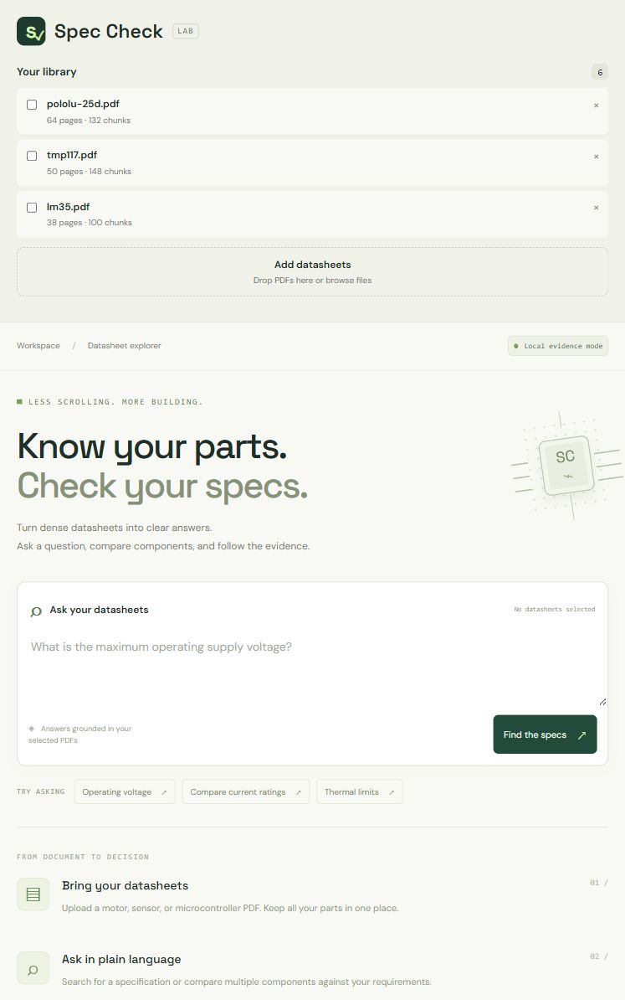
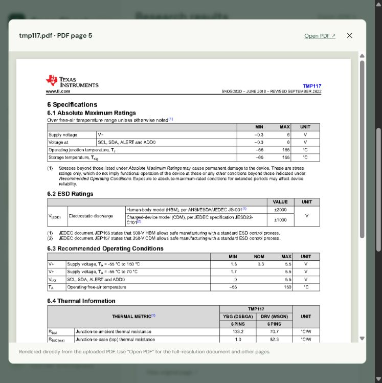
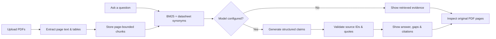

<div align="center">



### Less scrolling. More building.

Ask your hardware datasheets a question. Compare parts. Follow every answer back to its source.


[](LICENSE)


[Quick start](#quick-start) · [How it works](#how-it-works) · [Evaluation](#evaluation) · [Design document](docs/DESIGN.md)

</div>

---

## About

**Spec Check** is a datasheet research workspace for students and hardware engineers. Instead of searching hundreds of PDF pages and copying specifications into a spreadsheet, upload your datasheets, select your parts, and ask in plain language.

The app retrieves relevant text and tables, then optionally uses an LLM to produce short answers with source quotes and physical PDF page citations. Open the original page beside the evidence to check the number, unit, package, and operating conditions yourself.

Built by **Yash Gandre, Smera Das Gupta, and Prarth Gupta** for **CSCE 289 · AI for Engineers** at Texas A&M University.

> **Project status:** Working prototype with local and Vercel hosting modes. Search and source viewing work without an API key. Live LLM validation and final graded accuracy measurements are pending class API access and verified benchmark answers.

## A closer look



<details>
<summary><strong>See the original source-page viewer</strong></summary>



Source pages render directly from uploaded PDFs, including in browsers without an embedded PDF viewer.

</details>

## What you can do

| Capability | What it gives you |
| :--- | :--- |
| **Build a parts library** | Upload PDFs, keep them locally, and deduplicate identical files. |
| **Search across components** | Select up to eight datasheets and retrieve evidence for each part. |
| **Keep tables in context** | Extract page text and bordered tables with page-bounded chunks. |
| **Ask for cited answers** | Configure a model to generate claims with exact source quotations. |
| **Inspect the source** | Open the physical PDF page behind an excerpt or citation. |
| **Handle missing evidence** | Support explicit abstentions and partial answers instead of requiring a guess. |
| **Keep your findings** | Export a question, response, evidence, and citations as JSON. |

## Quick start

Install [uv](https://docs.astral.sh/uv/getting-started/installation/), then run:

```bash
git clone https://github.com/Prarth314/spec-check.git
cd spec-check
uv sync --python 3.12
uv run uvicorn spec_check.app:app --host 127.0.0.1 --port 8001
```

Open **[localhost:8001](http://127.0.0.1:8001)**. Interactive API documentation is at **[/docs](http://127.0.0.1:8001/docs)**.

On Windows, you can also start the project with:

```powershell
./run.ps1
```

### Try the sample corpus

```bash
uv run python scripts/fetch_datasheets.py --ingest
```

| Part / family | Component type |
| :--- | :--- |
| Pololu 25D | DC gearmotors |
| TMP117 | Digital temperature sensor |
| LM35 | Analog temperature sensor |
| ADS1115 | Analog-to-digital converter |
| ATmega328P | Microcontroller · automotive datasheet revision |
| DRV8833 | Dual H-bridge motor driver |

Downloads come from manufacturer websites. The downloader records SHA-256 hashes so evaluations can identify the exact PDF revisions. Datasheets and application data stay outside Git.

### Enable LLM answers

Copy `.env.example` to `.env` and supply your class-approved credentials:

```dotenv
OPENAI_API_KEY=your-api-key
OPENAI_MODEL=your-approved-model
OPENAI_BASE_URL=https://api.openai.com/v1
```

Restart the server. The configured model must support Chat Completions with JSON object output. A compatible class-provided endpoint can be configured through `OPENAI_BASE_URL`.

**Without a key and model:** everything stays in local evidence mode. **With them configured:** the question and retrieved chunks are sent to the configured provider to generate an answer. Keys remain on the server and `.env` is ignored by Git.

## How it works



The retrieval baseline uses **BM25 with explicit datasheet synonyms**, including voltage, current, thermal, and pinout vocabulary. It reserves evidence slots across selected documents. The server validates cited chunk IDs and exact source quotes, then attaches page numbers from its own extraction records.

Exact quote matching verifies provenance; it does **not** prove that a model interpreted a specification correctly. Merged cells, diagram pinouts, conditions, units, and absolute maximum versus operating ratings still need careful review. OCR, chart interpretation, embeddings, and production multi-user hosting are outside this prototype's scope.

## Deploy on Vercel

Import this repository, choose the **FastAPI** preset, and keep the Root Directory at `./`. The entry point and Python 3.12 runtime are declared in the repository; no custom build command is required.

On Vercel, your library is saved in **your browser**, so it survives server restarts and stays separate from other visitors. PDFs are sent to Python for extraction and source previews. The hosted upload limit is **4 MB per PDF**, with up to **3 MB of extracted text per question**. The local app keeps its SQLite library and 20 MB upload limit. Clearing browser site data removes a hosted library; it does not sync across devices or hostnames.

Add your provider key/model to the Vercel project's environment settings to enable generated answers. See the [deployment guide](docs/VERCEL.md) for limits, privacy behavior, and verification steps.

## Evaluation

The benchmark template contains **24 questions across six datasheets**, covering:

- Operating voltage ranges and absolute maximum ratings
- Current ratings, thermal limits, and package-specific pinouts
- Cross-part comparisons with evidence for both components
- Missing specifications that should trigger abstention

Run each question three times:

```bash
# Generated-answer evaluation; requires API configuration
uv run python scripts/evaluate.py --repeats 3

# Retrieval-only dry run; no API key required
uv run python scripts/evaluate.py --repeats 3 --allow-evidence-only
```

The runner saves raw responses, corpus hashes, evidence, citations, and blank grading records. Complete and independently review the gold labels in [`evaluation/questions.json`](evaluation/questions.json), grade the responses, then generate a report:

```bash
uv run python scripts/report.py evaluation/runs/<timestamp>
```

Reports separate exact specification accuracy, citation page-match, citation support, negative-test abstention, retrieval coverage, provider errors, and repeat consistency. **Ungraded results remain null.** A retrieval dry run is not an answer-accuracy result.

## Development

```bash
uv run pytest -q
node --check static/app.js
```

The initial verification passed **16 automated tests** and completed **72 retrieval-only requests**. Provider integration is tested with a mock; live model accuracy has not been measured. See the [verification record](docs/VERIFICATION.md) for scope and remaining checks.

```text
spec-check/
├── spec_check/          # API, extraction, storage, retrieval, answer validation
├── static/              # Responsive HTML, CSS, and JavaScript interface
├── evaluation/          # Manufacturer sources and 24-question benchmark template
├── scripts/             # Downloads, repeated evaluation, and metric reports
├── tests/               # Deterministic PDF, API, citation, and evaluation tests
├── docs/                # Architecture, usage guide, and verification evidence
├── .env.example         # Provider configuration template
├── run.ps1              # Windows launcher
└── uv.lock              # Reproducible dependency versions
```

## Documentation

| Guide | Contents |
| :--- | :--- |
| [Design document](docs/DESIGN.md) | Problem, architecture, acceptance criteria, risks, and timeline |
| [Detailed usage](docs/USAGE.md) | Setup alternatives, configuration, sample downloads, and grading protocol |
| [Verification record](docs/VERIFICATION.md) | Completed checks and pending empirical evaluation |
| [Vercel deployment](docs/VERCEL.md) | Hosted storage, upload limits, configuration, and verification |
| [Benchmark template](evaluation/questions.json) | All 24 questions and gold-label fields |
| [Manufacturer sources](evaluation/datasheets.json) | Six declared sample PDFs and their download URLs |

## Team

**Yash Gandre** · **Smera Das Gupta** · **Prarth Gupta**  
Texas A&M University · CSCE 289 · Fall 2026

## License

Original project code and documentation are available under the [MIT License](LICENSE). Manufacturer datasheets and third-party materials shown in source previews retain their respective owners' rights.

---

<div align="center">
<sub><strong>Spec Check</strong> · Know your parts. Check your specs.</sub>
</div>
