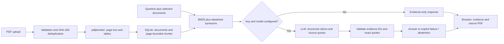

# Spec Check — Design document

**Team:** Yash Gandre, Smera Das Gupta, Prarth Gupta  
**Course:** CSCE 289, AI for Engineers  
**Prepared:** October 31, 2026

## Problem and users

Students and hardware engineers spend time searching lengthy datasheets for voltage ranges, current limits, thermal limits, and pin definitions. Manual Ctrl+F searches miss different names for the same quantity, and spreadsheet comparisons require someone to find and transcribe each value first. Similar part numbers, units, and maximum versus typical columns make transcription errors easy.

Spec Check provides a small research workspace that connects a natural-language question to source evidence. An LLM can interpret phrasing and summarize relevant passages, while retrieval restricts the evidence it sees. The system must expose uncertainty rather than silently inventing missing specifications.

## Scope and acceptance criteria

The prototype accepts one or more digital datasheet PDFs and a question. An answer must identify the relevant part, give the value/unit and conditions, and link to the supporting physical PDF page. For a comparison it must support each compared part. Missing or ambiguous evidence should produce abstention or a partial answer with the gap described. Without class-funded API access, local retrieval and source inspection remain usable.

The initial implementation supports files up to 20 MB and 500 pages, at most eight selected datasheets per question, page text plus bordered tables, persistent local storage, and a responsive browser UI. It does not implement OCR, image or graph interpretation, cross-page table reconstruction, document revision resolution, embeddings, user accounts, or production hosting.

## Architecture

**Stack:** Python 3.11+, FastAPI, Uvicorn, pdfplumber, SQLite, HTTPX, plain HTML/CSS/JavaScript. A lockfile captures tested dependencies. No paid embedding service or vector database is required for this corpus size. The baseline computes BM25 over the selected documents at query time; a larger corpus would need an indexed backend.

### Extraction and chunking

Each page is processed separately. Text is split at line boundaries into approximately 2,400-character windows with 350-character overlap. Bordered tables become Markdown rows, with headers repeated for row groups of approximately 3,000 cell characters. A chunk never crosses a PDF page. Every chunk stores a database ID, document ID, one-based physical page, kind (`text` or `table`), and content. Original PDF bytes remain available in local storage.

Very large individual table rows can exceed the target group size. Borderless tables and merged/multilevel headers can still produce poor results. Little extractable text triggers a page warning; wholly unreadable documents are rejected. No claim is made that tables or diagram pinouts are always parsed correctly.

### Retrieval

Tokenize without dropping decimal points, expand a small set of known datasheet synonyms, and rank selected chunks with BM25. Real query terms have more weight than expanded terms. A chunk must match an original query term. Reserve slots per selected document so one part cannot consume all twelve evidence slots. Unmatched documents are not replaced with invented evidence.

This meets the requirement to store and search chunks while providing a reproducible baseline. Embedding-based retrieval and reranking are possible upgrades if paraphrase evaluation shows recall gaps. Retrieval scores are rankings, not confidence probabilities.

### Answer generation and provenance

The server sends only the question and retrieved chunks to the configured provider. Instructions require preserving part identifiers, package, units, min/typ/max columns, operating versus absolute maxima, and measurement conditions. The response contains status, claims, source IDs, exact quotations, and a missing-evidence explanation. Pydantic checks the shape; the server checks that every ID was retrieved and each quoted excerpt appears in that chunk after whitespace normalization. Page numbers are attached from SQLite, never accepted from the model.

Invalid citations or provider failures produce an explicit error while keeping the evidence visible. Exact quote checks prevent fabricated provenance but do not establish semantic entailment. A claim can still misread a real quote; human evaluation and source viewing remain essential. Repeated calls are not guaranteed deterministic.

### Data and interfaces

`documents`: ID, filename, SHA-256, page count, chunk count, extraction warnings, upload time.  
`chunks`: ID, document foreign key, physical page, type, extracted content. Deleting a document cascades to its chunks and removes its original PDF.

| Endpoint | Purpose |
| --- | --- |
| `GET /api/health` | Server status and model configuration state |
| `GET /api/documents` | Library metadata and extraction warnings |
| `POST /api/documents` | Validate, extract and store one uploaded PDF |
| `DELETE /api/documents/{id}` | Remove the original PDF and extracted records |
| `GET /api/documents/{id}/pdf` | View the original source |
| `GET /api/documents/{id}/pages/{page}.png` | Render a bounded-size image of the exact source page |
| `POST /api/ask` | Retrieve evidence and optionally generate a cited answer |

Questions and generated results are not persisted by the server; users may export a result as JSON. The offline evaluation runner saves its responses locally.

## Risk controls and remaining limitations

| Risk | Implemented mitigation | Remaining limit / test |
| --- | --- | --- |
| Invented number or source | Exact quote validation, server-owned page metadata, evidence UI | Valid quotations can still be interpreted incorrectly; manually grade entailment |
| 12 V versus 1.2 V, A versus mA | Preserve source spelling and decimal punctuation | No automatic numeric reasoning verifier; include unit/decimal questions |
| Similar part or wrong package | Require precise identifiers in prompt; user selects PDFs | Family datasheets still require correct row/package selection |
| Absolute maximum used for operating choice | Explicit instructions and comparisons that test it | Prompting cannot guarantee compliance |
| Scrambled tables / diagram pinouts | Markdown tables, page viewer, extraction warnings | OCR, graph reasoning and borderless-table reconstruction deferred |
| Absent specification | Negative cases; explicit abstention statuses | Lexical overlap can retrieve irrelevant evidence; test provider behavior |
| Prompt injection in uploaded documents | Treat questions/evidence as data; no model tools or actions | Model could still follow hostile text and produce bad prose |
| Different wording / repeat instability | Three repeats; separate paraphrase protocol | Baseline synonym coverage is finite |
| Unknown API funding | No-key retrieval mode; configurable endpoint/model | Real LLM integration requires class credentials and live validation |

## Evaluation plan

The sample corpus declares six manufacturer PDFs covering a motor family, two temperature sensors, an ADC, a microcontroller, and a motor driver. ADS1115 replaces the initially considered LIS3DH because ST's global and regional download endpoints repeatedly timed out during setup. The manifest and actual downloaded SHA-256 hashes identify the tested revisions. The automotive ATmega328P revision must not be conflated with a different commercial revision.

The benchmark template contains 24 questions: operating voltage, absolute maximum ratings, current, thermal limits, package-specific pinouts, cross-part comparisons, and two absent-spec questions. It expands the proposed three-datasheet smoke test to the instructor's requested 20–25 questions across 5–8 datasheets.

1. Freeze and inspect all PDFs. Two reviewers record exact expected answers, conditions and physical source pages in `evaluation/questions.json`; `gold: null` entries are explicitly unannotated.
2. Ask each question three times against identical files and model settings (72 requests). Record the model and preserve raw responses, evidence, and citations.
3. Manually score exact specifications: a response is correct only if its values, units, part/package, rating type, and relevant conditions match the annotated source. For comparisons every part and the decision must be correct. Missing expected answers and provider errors are incorrect for positive cases.
4. Compute strict citation page-set match automatically for annotated positive cases; manually judge whether every factual claim is actually supported by its citation. Page correctness alone is insufficient.
5. Score negative cases for abstention without invented specifications. Do not treat a provider error as a successful abstention.
6. Report per-run counts and denominators, category breakdowns, error count, retrieval page coverage, exact-output consistency, and manually inspected semantic consistency. Missing grades remain null, never 0% or 100%.
7. Create a separate paraphrase set for the three initial smoke questions and compare correctness across wording. Identical repeats measure stability, not paraphrase robustness.

Scripts `evaluate.py` and `report.py` implement repeated execution, response capture, grading templates and aggregate rates. A no-key run is a retrieval dry run and cannot establish answer accuracy. Final class accuracy and citation-match results remain pending until gold annotations, API access and grading are complete.

## Timeline and deliverables

| Date (2026) | Planned deliverable | Review criterion |
| --- | --- | --- |
| Oct 25 | Choose five datasheets; PDF extraction milestone | Inspect voltage/current tables against PDFs |
| Nov 1 | Design document and retrieval milestone | Stored page-bounded chunks; relevant search evidence |
| Nov 8 | Integrate class API access and finalize gold labels | Claims cite correct evidence; all 24 cases annotated |
| Nov 15 | Complete QA and evaluation | 72 runs, graded accuracy and page-match results, demo |

The dates preserve the team's proposal. They are milestone targets, not claims that past work was completed on those dates. The repository now supplies the app, design document, sample-download workflow, benchmark template and automated tests. Live provider validation and final empirical evaluation depend on class API access.

## Sources

- [pdfplumber](https://github.com/jsvine/pdfplumber): primary extraction API documentation.
- [OpenAI structured outputs](https://developers.openai.com/api/docs/guides/structured-outputs): provider JSON-output contract.
- Manufacturer download links are maintained in `evaluation/datasheets.json`; no hardware specifications in this document are inferred from search snippets.
